<div align="center">


<br/>


### Proyecte la Palabra y la alabanza en el proyector de la iglesia y en la transmisión en vivo, desde un solo panel.

**[Funciones](#-funciones)** ·
**[Capturas](#-capturas)** ·
**[Instalación](#-instalación)** ·
**[OBS Studio](#-obs-studio)** ·
**[Control móvil](#-control-desde-el-celular)** ·
**[Idiomas](#-idiomas)** ·
**[Atajos](#atajos)** ·
**[Manual PDF](Manual%20PK-PENTECOSTAL.pdf)**

</div>

---

## ✨ ¿Qué es PK-PENTECOSTAL?

**PK-PENTECOSTAL** es un software gratuito para iglesias que muestra **versículos de la Biblia, letras de canciones, anuncios y rótulos con nombres** en:

- 📽️ **El proyector o el TV de la iglesia**, a pantalla completa con fondos de imagen o video.
- 🎬 **La transmisión en vivo con OBS Studio**, como capa transparente (tercio inferior, banner o pantalla completa).
- 📱 **Cualquier celular o iPad**, que sirve como control remoto con solo escanear un código QR.

Todo corre en **un solo computador**, se maneja desde el **navegador** y **no necesita internet** durante el culto.

<div align="center">


</div>

---

## 🚀 Funciones

<table>
<tr>
<td width="50%" valign="top">

### 📖 Biblia
- **9 versiones**: Reina Valera 1960, NVI, NTV, Dios Habla Hoy, TLA, PDT, King James, World English Bible y Bible in Basic English.
- Búsqueda por referencia en lenguaje natural: `jn 3 16`, `sal 23`, `1 co 13:4-7`.
- Búsqueda por palabras en toda la Biblia.
- Varios versículos juntos con **Shift + clic**.
- Pasa de capítulo automáticamente con las flechas.
- Historial de lo que se proyectó.

</td>
<td width="50%" valign="top">

### 🎵 Canciones
- **6 cancioneros** incluidos: Corario IPUC Castilla, Himnario Lluvias de Bendición, Infantiles, Mi Cancionero, Manantial de Inspiración y Canciones.
- Editor de canciones integrado con **respaldo automático** antes de cada cambio.
- Teclas **1..9** para saltar a la estrofa que quiera.
- Respeta repeticiones `//así//`, coros y estrofas numeradas.

</td>
</tr>
<tr>
<td valign="top">

### 🎬 Módulo OBS
- Capas listas para **Fuente de Navegador** (1920×1080 transparente).
- **Rótulos** de nombres con un clic, listas, colores, temporizador, borde y plantillas.
- **Banner** con fondo de imagen/video y efectos: partículas, nieve, bokeh, estrellas y rayos.
- Control de OBS por **WebSocket**: botón TRANSMITIR, escenas con miniaturas, Stinger, transiciones, cámaras y audio con vúmetros.

</td>
<td valign="top">

### 📽️ Proyector y pantallas
- Botón **Proyectar**: abre sola la ventana en la 2ª pantalla a pantalla completa.
- Fondos de **imagen o video** (y suba los suyos desde el panel).
- Estilo a su gusto: fuente, tamaño, sombra, contorno, mayúsculas, alineación y transiciones.
- **Pantalla negra**, **ocultar texto** y **limpiar** con una tecla.

</td>
</tr>
<tr>
<td valign="top">

### 📱 Control desde el celular
- Escanee un **código QR** y el teléfono queda vinculado. Sin instalar nada.
- Vistas **Elegir · Diapositivas · Monitor** y barra de control ◀ Negro Ocultar Limpiar ▶.
- Solo los teléfonos vinculados pueden cambiar lo que se proyecta.
- **Wi-Fi propio**: el computador crea la red `PK-PENTECOSTAL` cuando no hay Wi-Fi o la red bloquea equipos (Windows).

</td>
<td valign="top">

### 🌐 Idiomas
- Interfaz en **Español latino, English US y English UK**; cambia al instante en el computador y en los celulares.
- Cada Biblia en español tiene su **pareja en inglés** (RV1960 → KJV, NVI/NTV → WEB, DHH/TLA/PDT → BBE).
- Canciones traducidas al inglés y **traductor automático con IA que funciona sin internet**.

</td>
</tr>
</table>

---

## 📸 Capturas

<div align="center">

### Panel principal · Biblia
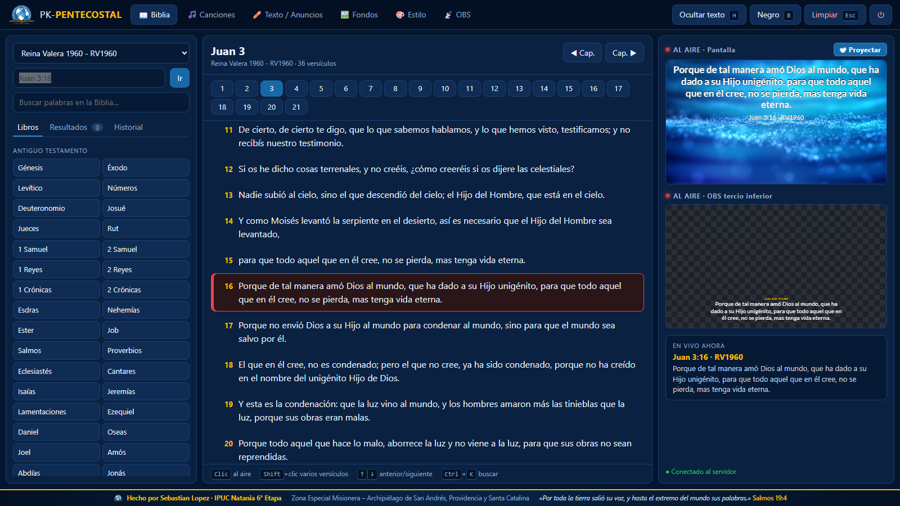

<br/><br/>

### Así se ve en el proyector
<table>
<tr>
<td></td>
<td></td>
</tr>
<tr>
<td align="center"><b>Versículo</b></td>
<td align="center"><b>Letra de canción</b></td>
</tr>
</table>

<br/>

### Canciones y estilo
<table>
<tr>
<td>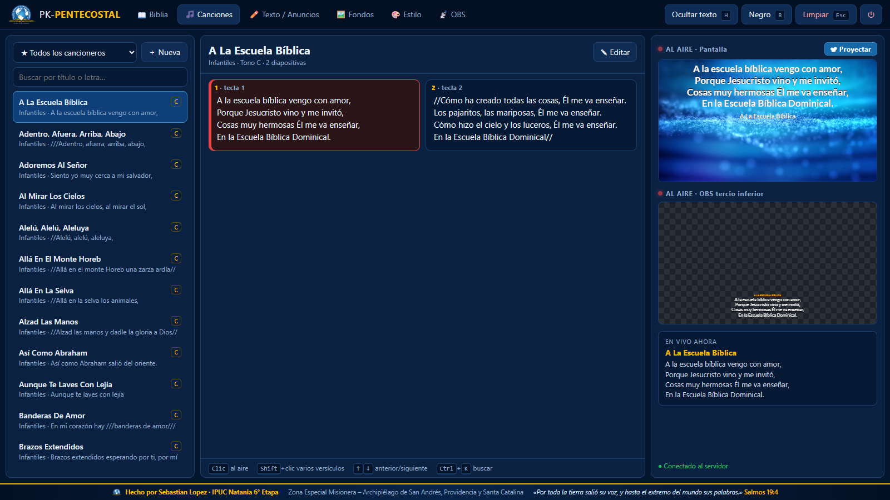</td>
<td>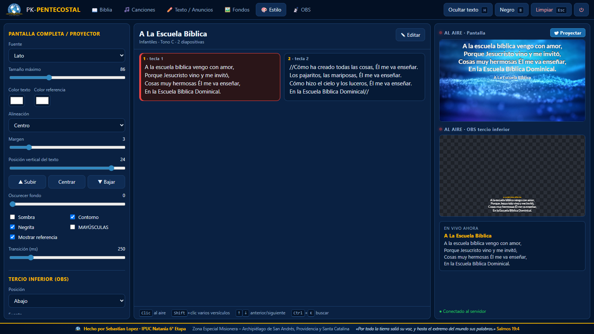</td>
</tr>
<tr>
<td>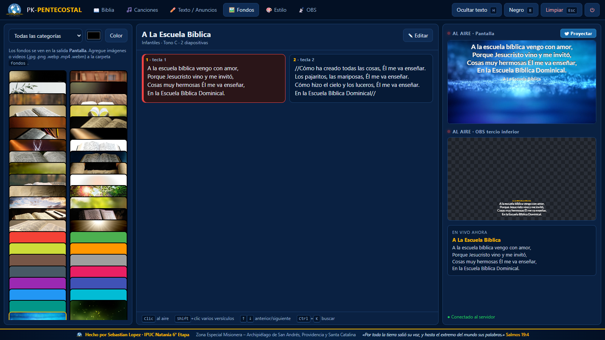</td>
<td>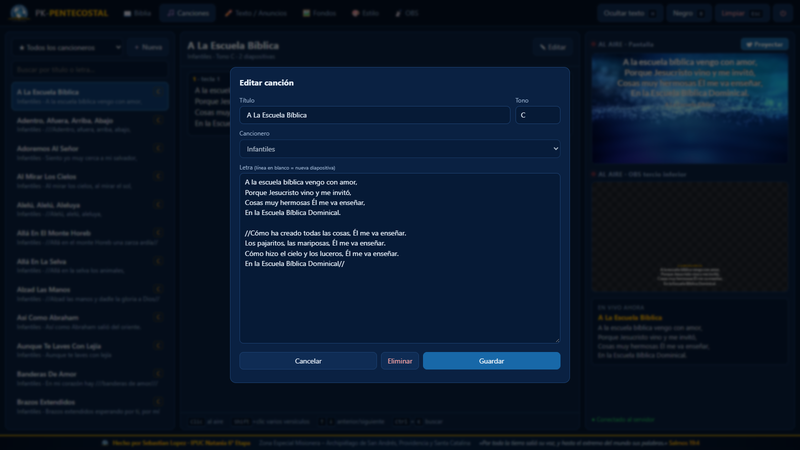</td>
</tr>
</table>

<br/>

### Módulo OBS · Rótulos y Banner
<table>
<tr>
<td>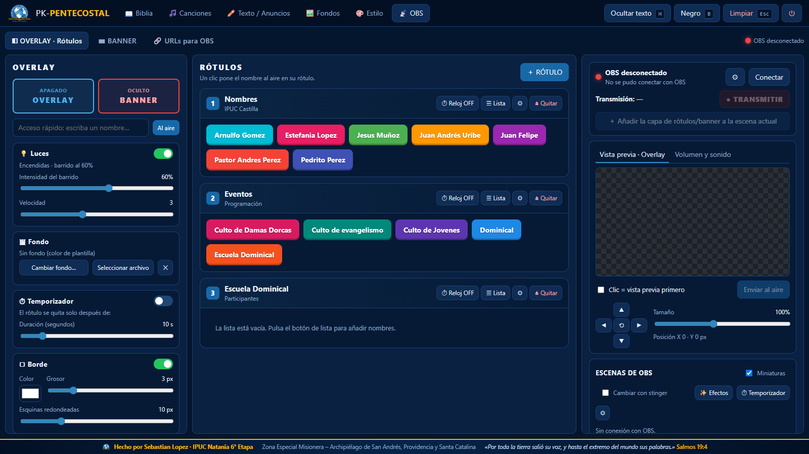</td>
<td>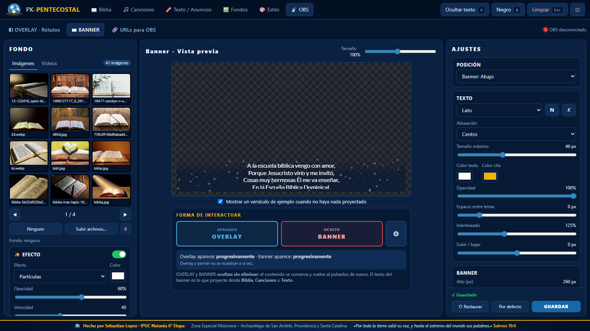</td>
</tr>
<tr>
<td colspan="2">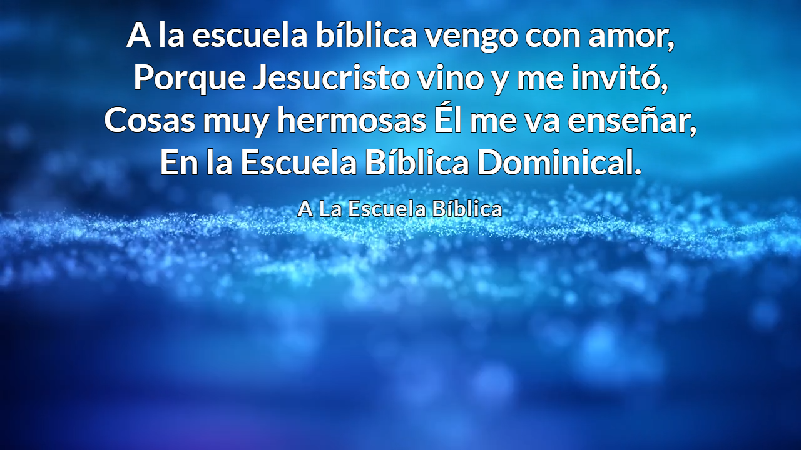</td>
</tr>
</table>

<br/>

### Control desde el celular
<table>
<tr>
<td width="25%">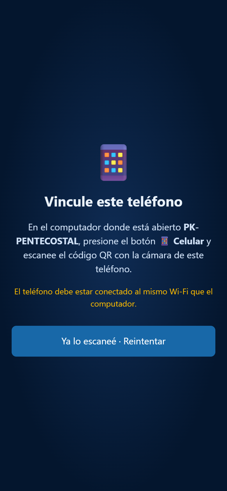</td>
<td width="25%">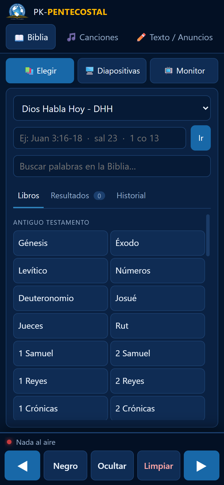</td>
<td width="25%">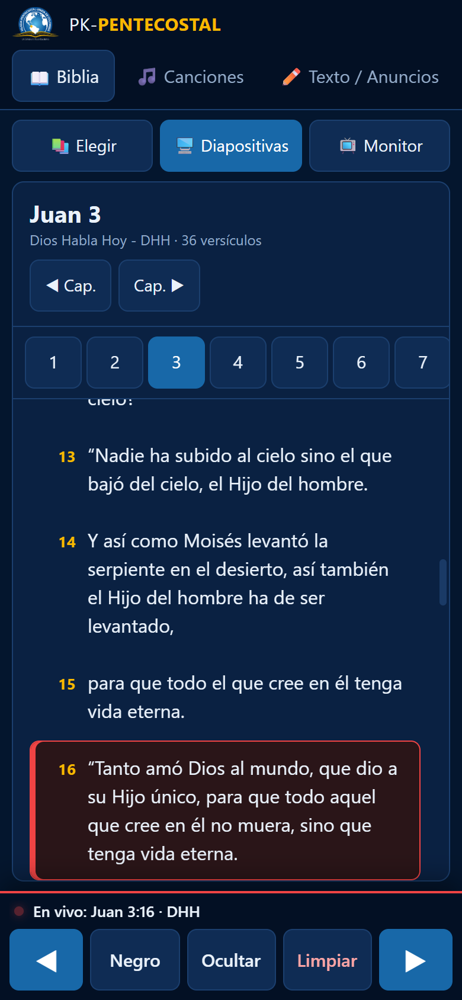</td>
<td width="25%">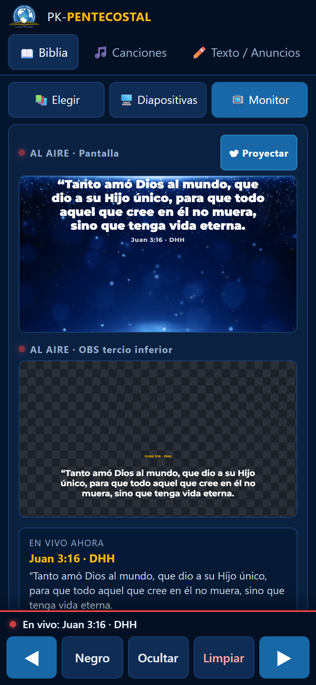</td>
</tr>
<tr>
<td align="center">Vincular</td><td align="center">Elegir</td><td align="center">Diapositivas</td><td align="center">Monitor</td>
</tr>
</table>
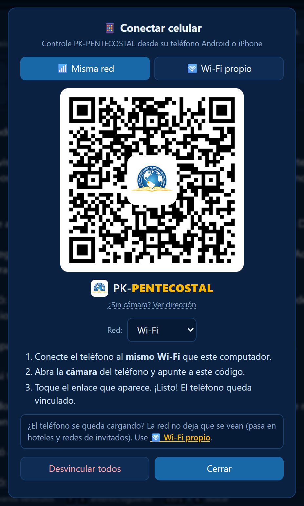

<br/><br/>

### Bilingüe · English
<table>
<tr>
<td>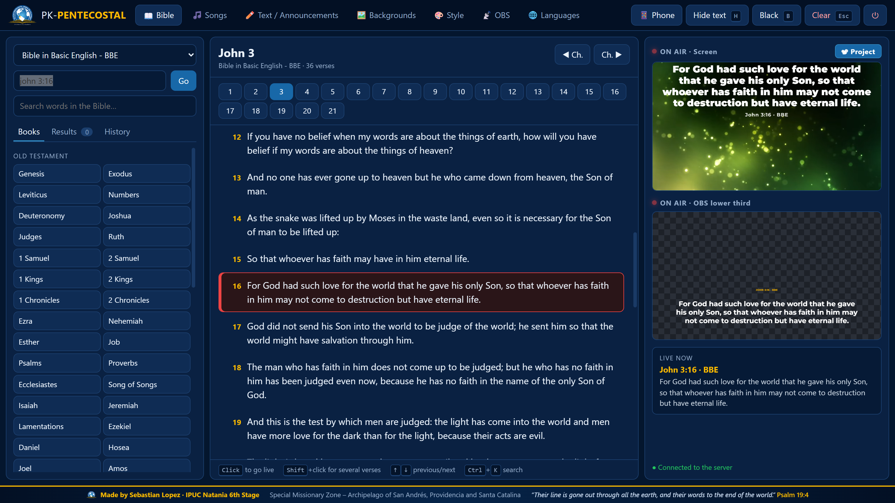</td>
<td>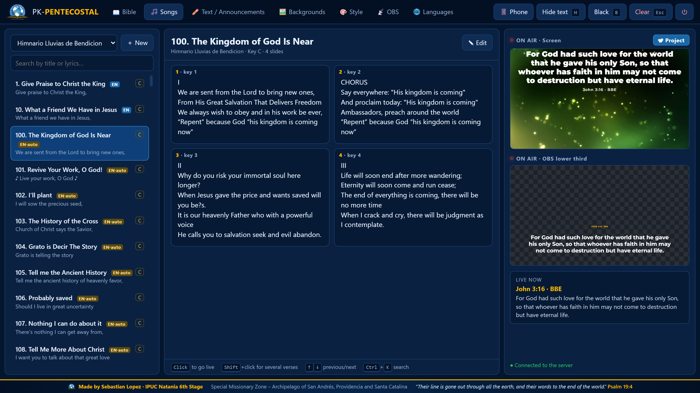</td>
</tr>
</table>

<br/>

### Pantallas de bienvenida y cierre
<table>
<tr>
<td></td>
<td></td>
</tr>
</table>

</div>

---

## 🧭 Cómo funciona

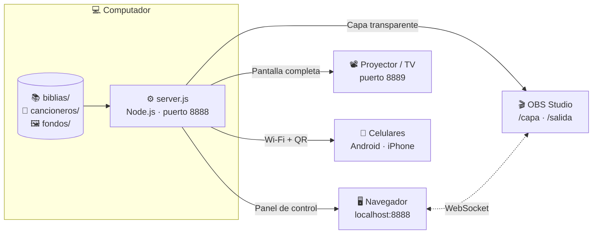

El servidor está hecho en **Node.js puro, sin dependencias**: no hay que instalar paquetes para usar el programa. Solo el traductor automático (opcional) usa una librería extra.

---

## 📦 Instalación

### 1. Requisito (una sola vez)
Instale **[Node.js](https://nodejs.org) 16 o superior** (versión **LTS**, gratis). Si no está instalado, los lanzadores lo avisan y abren la página de descarga.

### 2. Descargue el programa

```bash
git clone <URL-de-este-repositorio>
```

o use el botón verde **Code → Download ZIP** y descomprímalo.

### 3. Ábralo

| Sistema | Cómo abrirlo |
|---|---|
| 🪟 **Windows** | Doble clic en **`PK-PENTECOSTAL.vbs`** (sin ventana negra) o **`PK-PENTECOSTAL.bat`** (muestra las direcciones y los errores). Para crear el acceso directo con logo: **`Crear acceso directo (Windows).vbs`**. |
| 🍎 **macOS** | Doble clic en **`iniciar-mac.command`** (la primera vez: clic derecho → Abrir). |
| 🐧 **Linux** | `chmod +x iniciar-linux.sh && ./iniciar-linux.sh` · Para agregarlo al menú: `./iniciar-linux.sh --instalar` |

El panel se abre en el navegador en **http://localhost:8888**.

### 4. (Opcional) Traductor automático sin internet

```bash
cd PK-PENTECOSTAL/traductor
npm install
```

Instala la librería y descarga **una sola vez** el modelo abierto *Helsinki-NLP opus-mt-es-en* (~115 MB). Después traduce canciones al inglés sin conexión.

---

## 🎬 OBS Studio

**Fuentes → + → Navegador** · Ancho **1920** · Alto **1080** · y una de estas URL:

| URL | Qué muestra |
|---|---|
| `http://localhost:8888/capa` | Rótulos + Banner *(recomendado)* |
| `http://localhost:8888/capa?solo=overlay` | Solo rótulos (nombres) |
| `http://localhost:8888/capa?solo=banner` | Solo banner (versículos / letras) |
| `http://localhost:8888/salida?modo=obs` | Tercio inferior clásico |
| `http://localhost:8888/salida?modo=pantalla` | Pantalla completa con fondo |
| `http://localhost:8888/salida?modo=pantalla&fondo=0` | Pantalla completa transparente |
| `http://localhost:8888/salida?modo=chroma` | Fondo verde (ATEM, vMix) |

> 💡 **Control de OBS desde el panel (OBS 28+):** en OBS vaya a *Herramientas → Ajustes del servidor WebSocket → Habilitar*. En el panel: pestaña **OBS → ⚙ → contraseña → Conectar**. También puede pulsar *"Añadir la capa…"* para que se cree sola.

---

## 📱 Control desde el celular

1. Conecte el teléfono al **mismo Wi-Fi** que el computador.
2. En el panel pulse **📱 Celular**.
3. Escanee el **código QR** con la cámara y toque el enlace. ¡Listo!

Para tenerlo como app: menú del navegador → **Agregar a pantalla de inicio**.
**Desvincular todos** genera un código nuevo y desconecta a todos los teléfonos.

> 🛜 **Sin Wi-Fi o en redes que bloquean** (hoteles, invitados): en la ventana del QR elija **Wi-Fi propio → Crear Wi-Fi propio**. Escanee el QR ① para unirse a la red y el QR ② para abrir el panel. *(Windows, hasta 8 teléfonos.)*

---

## 🌐 Idiomas

Pestaña **🌐 Idiomas** → elija **Español latino**, **English (US)** o **English (UK)**.

| Biblia en español | Pareja en inglés |
|---|---|
| Reina Valera 1960 | King James Version (KJV) |
| NVI · NTV | World English Bible (WEB) |
| DHH · TLA · PDT | Bible in Basic English (BBE) |

Las citas salen en inglés (*John 3:16*) y se puede buscar `juan 3:16` o `jn 3:16` en cualquier idioma. Las traducciones de canciones se guardan aparte en `cancioneros/traducciones/`, sin tocar los cancioneros originales.

---

<a id="atajos"></a>

## ⌨️ Atajos de teclado

| Tecla | Acción |
|---|---|
| `Clic` | Mandar al aire |
| `Shift` + `Clic` | Varios versículos juntos |
| `←` `→` / `Espacio` | Anterior / siguiente (cambia de capítulo solo) |
| `1` … `9` | Ir a la estrofa N de la canción |
| `Esc` | Quitar el texto del aire |
| `B` | Pantalla negra |
| `H` | Ocultar texto (deja el fondo) |
| `Ctrl` + `K` | Buscar referencia (`jn 3 16`, `sal 23`, `1 co 13:4-7`) |
| `Ctrl` + `S` | Guardar ajustes del módulo OBS |

---

## 🗂️ Estructura del proyecto

```text
PK-PENTECOSTAL/
├── PK-PENTECOSTAL.vbs / .bat      ← Abrir en Windows
├── iniciar-mac.command            ← Abrir en macOS
├── iniciar-linux.sh               ← Abrir en Linux
├── Manual PK-PENTECOSTAL.pdf      ← Manual de usuario completo
├── PK-PENTECOSTAL/
│   ├── server.js                  ← Servidor local (Node.js, sin dependencias)
│   ├── public/                    ← Panel, proyector, capas OBS y vista móvil
│   ├── traductor/                 ← Traductor español → inglés sin internet (opcional)
│   └── LEEME.txt                  ← Guía rápida en texto
├── biblias/                       ← Versiones de la Biblia
├── cancioneros/                   ← Cancioneros + traducciones al inglés
├── fondos/                        ← Imágenes y videos de fondo
├── css/font/                      ← Tipografías
├── Imagenes/                      ← Fondos de pantalla y ejemplos
└── docs/                          ← Manual (HTML → PDF) y documentos de diseño
```

Sus ajustes y rótulos se guardan en `PK-PENTECOSTAL/config.json`, que se crea solo la primera vez (no se sube al repositorio porque contiene las claves de los celulares vinculados).

---

## ❓ Problemas comunes

<details>
<summary><b>"El puerto 8888 está ocupado"</b></summary>

Otro programa usa el puerto (por ejemplo, el Proyektor original). Ciérrelo y abra PK-PENTECOSTAL de nuevo. Si el programa ya estaba abierto, volver a abrirlo solo muestra el panel.
</details>

<details>
<summary><b>El celular no abre la página</b></summary>

- Revise que ambos estén en el **mismo Wi-Fi** (no en datos móviles).
- Si el computador tiene varias redes, elija otra en **"Red:"**.
- Permita el programa en el Firewall de Windows (PowerShell como administrador):

```powershell
New-NetFirewallRule -DisplayName "PK-PENTECOSTAL (celulares en la red local)" -Direction Inbound -Protocol TCP -LocalPort 8888 -RemoteAddress LocalSubnet -Action Allow
```

- O use **Wi-Fi propio** desde la ventana del QR.
</details>

<details>
<summary><b>El proyector no se abre en la segunda pantalla</b></summary>

En Chrome / Edge, la primera vez acepte el permiso **"administrar ventanas en todas las pantallas"**. En otros navegadores, lleve la ventana al proyector y pulse **F** o **F11**.
</details>

---

<div align="center">

### 🙏 Hecho con amor

**Sebastián López** · IPUC Natania 6ª Etapa
Zona Especial Misionera — Archipiélago de San Andrés, Providencia y Santa Catalina 🇨🇴

<br/>

> *«Por toda la tierra salió su voz, y hasta el extremo del mundo sus palabras.»*
> **— Salmos 19:4**

<br/>


</div>
